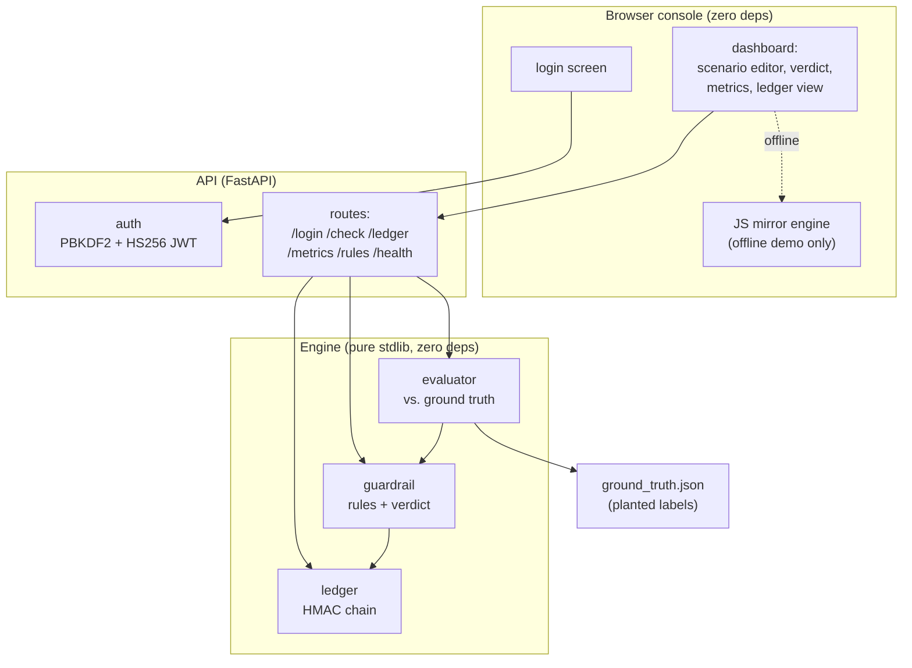
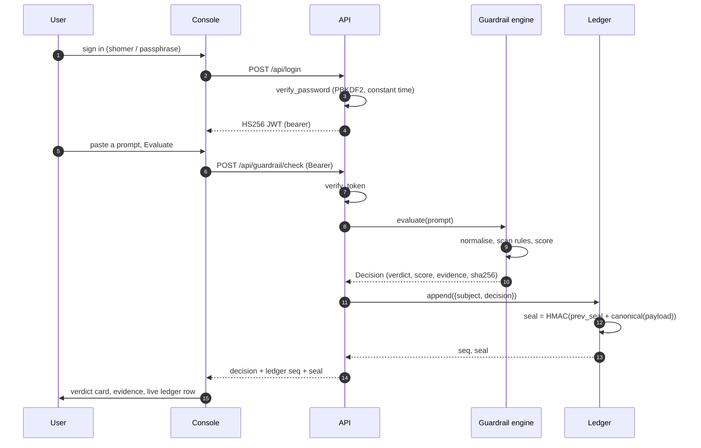
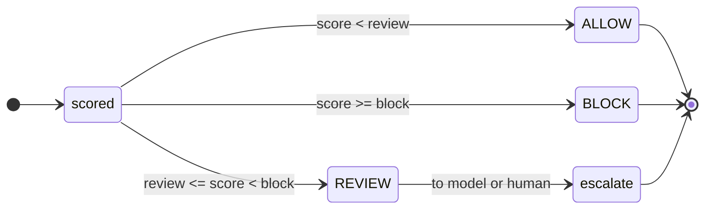
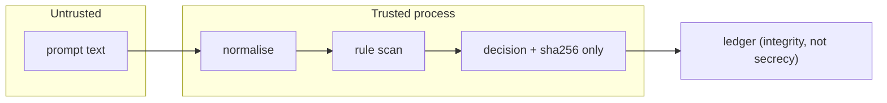
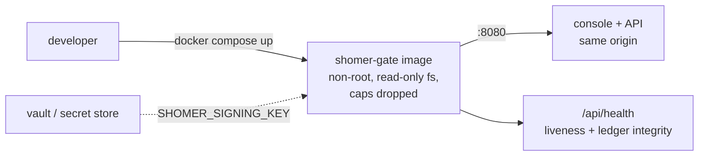

# Architecture

shomer-gate is a guardrail that sits in front of an LLM. A deterministic
baseline decides what happens to each prompt, the model is measured against that
baseline rather than trusted ahead of it, and every verdict is written to a
tamper-evident ledger.

## Components

The engine is the core and depends on nothing. The API is a thin shell that
wires the engine to HTTP and adds authentication. The browser console talks to
the API; with no backend reachable it falls back to a JavaScript mirror of the
same rules, so the demo still runs on a static host. The mirror is explicitly
not authoritative: the Python engine is the one the tests and the CI gate
measure.

## A request, end to end

## Verdict state machine

`REVIEW` is a real outcome, not a rounding of allow or block. It is the band
where the deterministic signal is present but not strong enough to block alone.
It is never scored as a catch when the baseline is measured.

## Trust boundary

The prompt is untrusted input. It is treated as data, never as instructions, and
it is reduced to a SHA-256 digest before anything is stored. The ledger proves
integrity and order; it does not keep the prompt content.

## Deployment

The container runs as an unprivileged user with a read-only root filesystem and
all Linux capabilities dropped. In production the signing key comes from a
secret store; the demo generates an ephemeral per-process key so it still runs
on a clean machine with no configuration.

## Where things live

| Path | What |
|------|------|
| `src/shomer_gate/guardrail/` | rules and the verdict engine |
| `src/shomer_gate/ledger/` | the HMAC-chained ledger |
| `src/shomer_gate/metrics/` | the evaluator and scorecard |
| `src/shomer_gate/api/` | FastAPI app and auth |
| `web/` | the static console (login, dashboard, mirror engine) |
| `data/ground_truth.json` | the planted evaluation set |
| `specs/` | spec-driven development documents |
| `docs/adr/` | architecture decision records |
