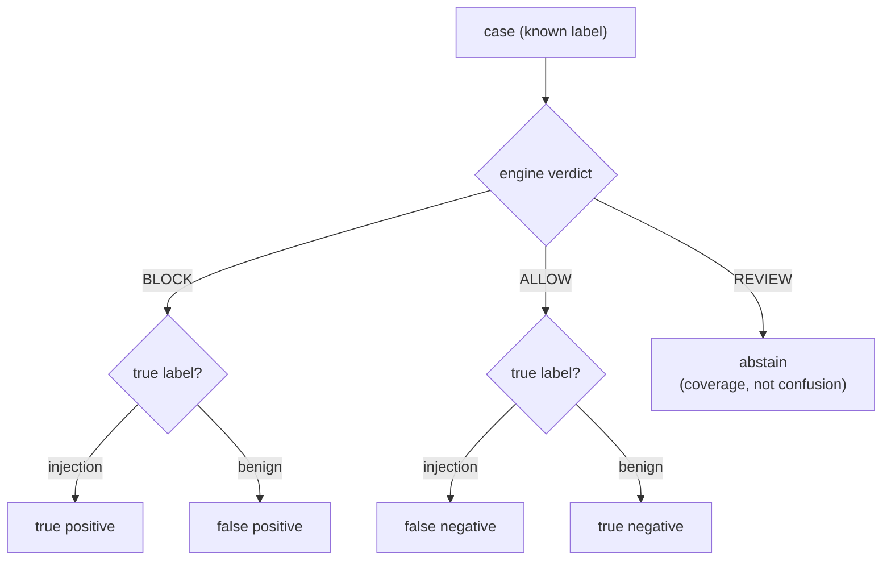

# Measurement

The baseline is measured, not asserted. The dataset in `data/ground_truth.json`
plants the attack on purpose: every case declares its true label and the
technique it exercises, so precision and recall are calculated rather than
estimated.

Run it yourself:

```bash
python -m shomer_gate eval
```

## The one rule of the arithmetic

A `review` verdict is an abstention. It is never counted as a catch and never as
a benign pass. It is reported separately as coverage. This is what stops a
baseline from inflating its recall by quietly sending every hard case to review.
A SKIP is never a PASS.



## Current scorecard

Measured on the committed dataset (42 cases) at thresholds block 7.0, review
3.0:

| Metric | Value |
|--------|-------|
| Precision | 1.00 |
| Recall | 1.00 |
| F1 | 1.00 |
| False positive rate | 0.00 |
| Coverage (decided / total) | 0.86 |
| Confusion (tp / fp / tn / fn) | 17 / 0 / 19 / 0 |
| Abstained (review) | 6 |

Recall is reported over the decided set. Every injection was either blocked or
abstained; none slipped to allow, so there are no false negatives. No benign
prompt was blocked, so the false positive rate is zero. Six prompts landed in
review, including deliberate single-signal attacks and one benign near-miss;
they lower coverage, which is the honest cost of not guessing.

## Recall by technique

The scorecard breaks recall out per declared technique rather than averaging it
into one number, so a weak spot is named instead of hidden. On the committed
set every technique with a decided case is caught at 1.00. The techniques that
appear only as single-signal cases abstain and are reported under coverage.

## Calibration

The weights and thresholds are data, not opinion. Change a weight in
`src/shomer_gate/guardrail/patterns.py` and rerun `shomer eval`: the scorecard
tells you what happened to recall and to the false positive rate.

The guiding trade-off: a single strong signal lands in review, not block, so
one borderline phrase does not block a user on its own. A block requires either
one very high-severity rule or two independent techniques stacking past the
threshold. That keeps the false positive rate at zero on the benign set while
still catching every clear, multi-signal attack.

## The CI gate

The pipeline runs the same evaluation and fails the build if recall drops below
0.80 or the false positive rate rises above 0.05:

```bash
python -m shomer_gate eval --min-recall 0.80 --max-fpr 0.05
```

A change that weakens the baseline does not merge.
