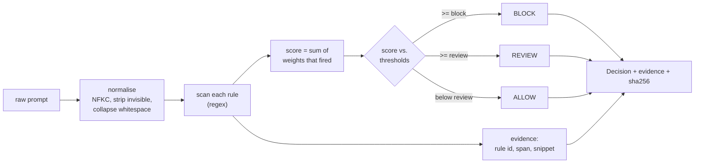

# Spec 001: Design

## Shape of the solution

A rule set and a pure function over it. No model, no state, no I/O.



## Rule model

Each rule is a frozen dataclass: a stable id (`IO-01`), a category, a severity
weight, a one-line rationale, and a compiled regex. The rule set is a tuple,
ordered by category for readability only. Order does not affect the score, which
is a pure sum over the rules that matched.

A rule contributes its weight once, no matter how many spans it matches. This
keeps calibration legible: a prompt that repeats one trick does not out-score a
prompt that combines two distinct techniques.

| Category | Rules | Example weight |
|----------|-------|----------------|
| instruction_override | IO-01, IO-02 | 5.0 |
| jailbreak_known | JB-01 | 5.0 |
| delimiter_spoof | DS-01, DS-02 | 4.5 |
| system_prompt_exfil | SE-01, SE-02 | 4.0 |
| data_exfil | DX-01 | 4.0 |
| role_hijack | RH-01 | 3.5 |
| encoding_evasion | EE-01 | 3.0 |
| refusal_suppression | RS-01 | 2.5 |

## Verdict as a state, not a boolean

The score maps to one of three verdicts. The band between the review and block
thresholds is the honest "not sure" region. See ADR 0002 for why this is three
states and not two.

```mermaid
stateDiagram-v2
  [*] --> ALLOW: score < review
  [*] --> REVIEW: review <= score < block
  [*] --> BLOCK: score >= block
  REVIEW --> note
  note: abstention, routed to a model or a human. Never scored as a pass.
```

## Confidence

Confidence is the normalised distance from the nearest decision boundary. For
`allow` and `block` it rises as the score moves away from the threshold. For
`review` it peaks in the middle of the band and falls toward either edge,
because that is exactly where the baseline is least sure.

## Normalisation

Normalisation runs before any rule. It folds Unicode with NFKC, strips
zero-width and bidi control characters, normalises line endings, and collapses
runs of spaces and tabs. Newlines are preserved, because a forged `system:`
role header is a line-anchored signal and collapsing lines would hide it.

## Privacy

The decision stores the SHA-256 of the prompt, never the prompt itself. The
ledger can therefore prove which prompt was judged without retaining the
content. See `docs/security.md`.

## Rejected alternatives

- **Model-first classifier.** Rejected as the baseline. A model cannot be the
  thing that measures whether the model helps, and at 3 a.m. an on-call needs a
  verdict they can argue with, not a score they must believe.
- **Binary allow/block.** Rejected. It forces the ambiguous middle into one of
  the two confident answers and hides the cases that most need a second look.
- **Weight per match rather than per rule.** Rejected. It lets a single
  repeated phrase dominate the score and makes calibration opaque.
