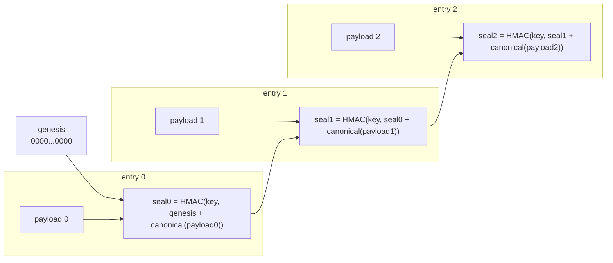
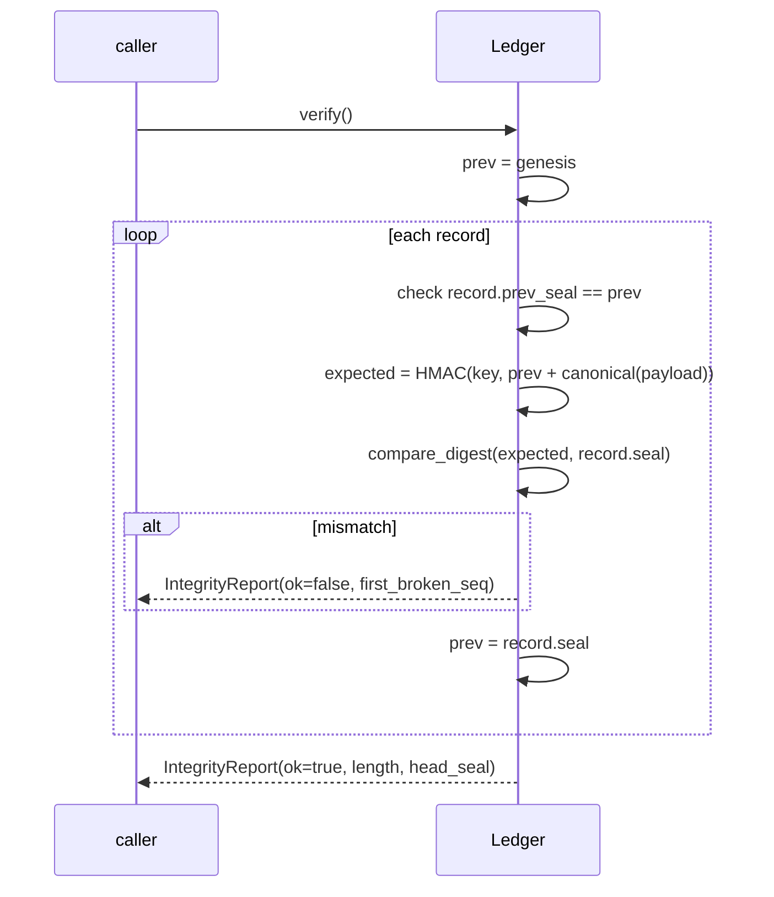

# Spec 002: Design

## The chain

Each entry seals the previous seal together with its own canonical bytes, using
HMAC-SHA256 under a secret key. The key makes the seal unforgeable: an attacker
who can write the file still cannot produce a valid chain without it.

Change `payload 1` and `seal1` no longer matches, so `seal2` built on it no
longer matches either. The break propagates to the head, and the verify pass
reports entry 1 as the first broken sequence.

## Canonicalisation

Seals are computed over canonical JSON: sorted keys, no insignificant
whitespace. Two logically equal payloads therefore produce identical bytes, so a
seal depends on content, not on formatting.

## Verification

All comparisons use constant-time digest comparison.

## Persistence

Persistence is append-only JSONL. On append the record is flushed; on
construction the file is loaded and the whole chain is verified, so a corrupt or
re-keyed file is rejected at startup rather than trusted.

The API keeps the ledger in memory by default, because the signing key may be
ephemeral per process and a persisted chain sealed under an old key would
correctly fail to load. Durable storage is a deployment choice that pairs a
stable key with a file path.

## Rejected alternatives

- **Plain hash chain (no key).** Rejected. It detects accidental corruption but
  an attacker who rewrites the file can recompute every hash. HMAC closes that.
- **Per-entry signature with a public key.** Heavier than needed for a
  single-writer log; HMAC under a vault key meets the obligation with less
  moving parts. Revisit if third parties must verify without the secret.
